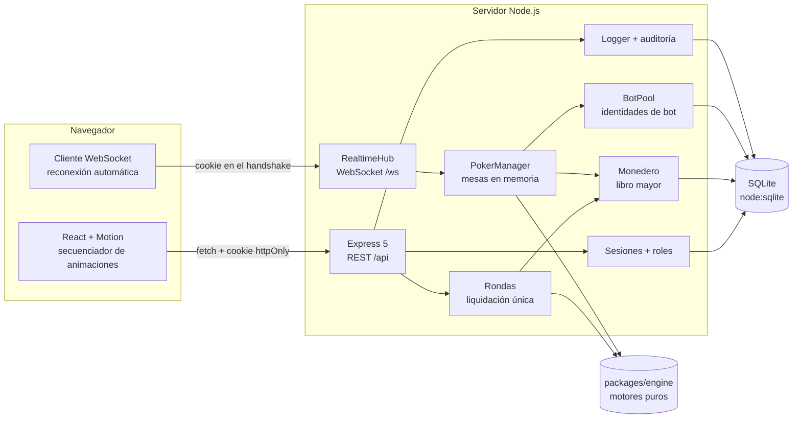
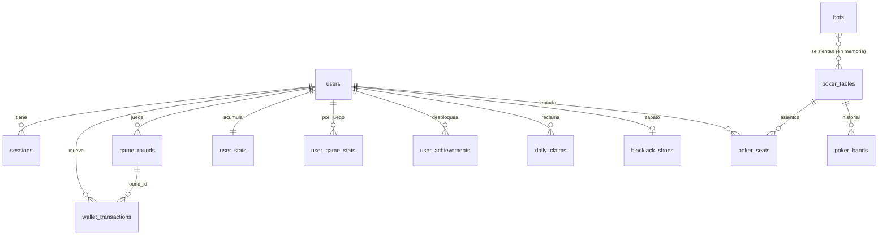
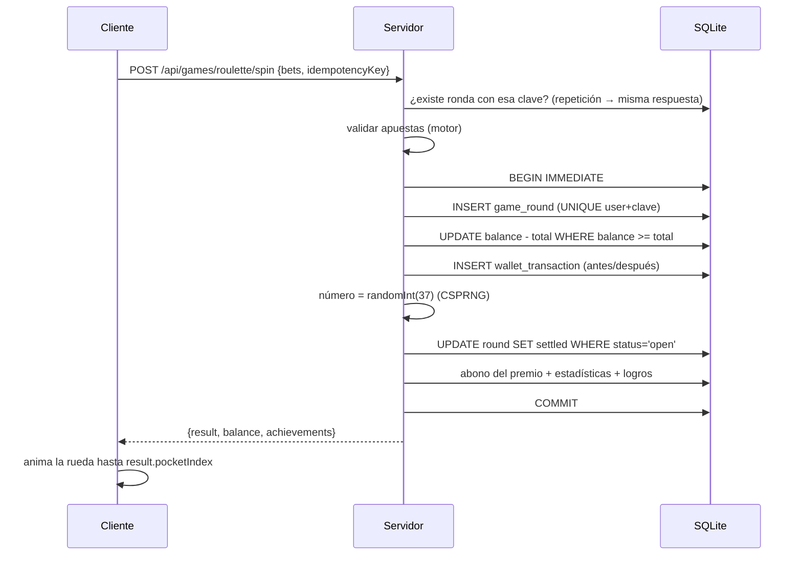

# Arquitectura

## Visión general

Monorepo con *npm workspaces* y tres paquetes:

| Paquete | Responsabilidad | Depende de |
| --- | --- | --- |
| `packages/engine` | Reglas puras de los juegos y de los bots. Sin E/S, sin UI, sin `Math.random()`: el azar se inyecta (`Rng`). | nada |
| `apps/server` | Autoridad única: sesiones, monedero, rondas, sorteos, mesas de póker, bots, administración. | engine |
| `apps/web` | Representación y animación. Nunca decide resultados ni importes. | engine (solo constantes y funciones puras de presentación) |



## Principios

1. **El servidor es la autoridad.** Cartas, números, paradas de rodillos, importes y roles se calculan y validan en el servidor. El cliente recibe un resultado ya decidido y lo anima.
2. **Motores puros.** Cada motor es una función o máquina de estados determinista dado un `Rng`. Se prueban sin servidor ni navegador.
3. **Animación separada de la lógica.** La interfaz traduce *eventos* del motor (`deal`, `reveal`, `street`, `award`…) a pasos de animación. Si se salta o se desactiva la animación, el estado final es el mismo.
4. **Abstracciones mínimas.** Repositorio SQL fino en lugar de un ORM; una sola clase de mesa de póker; sin capas intermedias sin uso.

## Persistencia

**Decisión: SQLite integrado en Node (`node:sqlite`) en lugar de Prisma + PostgreSQL.**

- Coste y fricción cero en Windows: no hay motor de base de datos que instalar ni binarios de Prisma que descargar o compilar.
- Las operaciones de saldo son **síncronas**: una transacción `BEGIN IMMEDIATE … COMMIT` se ejecuta de principio a fin sin que otra petición del mismo proceso pueda intercalarse. Además las actualizaciones son condicionales (`balance + ? >= 0`) y la columna tiene `CHECK (balance >= 0)`.
- Todas las consultas usan parámetros `?` (sin concatenación de datos del usuario).

**Camino a PostgreSQL**: el esquema (`apps/server/src/db/migrations/001_init.sql`) usa tipos portables (TEXT para UUID, INTEGER para importes enteros). Para migrar habría que sustituir la clase `Database` por un adaptador `pg` con la misma interfaz (`get/all/run/tx`), convertir `?` a `$n` y hacer asíncronas las transacciones, manteniendo `SELECT … FOR UPDATE` en el monedero. Los motores y la interfaz no cambian.

### Modelo de datos



Tablas auxiliares: `settings` (juegos habilitados, bonos), `audit_log`, `error_logs`, `schema_migrations`.

## Monedero y rondas



- **Idempotencia**: cada jugada lleva una clave única; una repetición devuelve la ronda original sin cobrar.
- **Liquidación única**: `UPDATE … WHERE status = 'open'` debe afectar exactamente a una fila; una segunda liquidación falla y no abona.
- **Blackjack**: la ronda queda `open` entre acciones con el estado (incluido el zapato) en `state_json`, que nunca se envía al cliente. Cada acción lleva `seq`; un número desfasado o repetido se rechaza (409).
- **Administradores**: saldo ilimitado. Los movimientos se registran con `unlimited = 1` y el saldo guardado no cambia. El rol se lee siempre de la base de datos.

## Póker en tiempo real

```mermaid
sequenceDiagram
  participant H as Humano (WS)
  participant T as PokerTable
  participant B as Bot
  T->>T: entre manos: salen bots sobrantes o sin fichas, entran bots si faltan jugadores
  T->>T: startHand (motor, CSPRNG)
  T-->>H: poker.update {events, snapshot filtrado}
  Note over T: espera el tiempo de animación de los eventos
  T->>B: turno: vista con SUS cartas + información pública
  B-->>T: decisión (Monte Carlo acotado en tiempo)
  T-->>H: poker.update
  T->>H: turno humano (25 s; 6 s si está desconectado)
  H-->>T: poker.act {handId, actionCount, action}
  T->>T: valida turno, secuencia e importes
  T-->>H: poker.update … showdown, award, hand_end
  T->>T: guarda la mano, estadísticas de humanos y fichas en poker_seats
```

- Cada observador recibe una **instantánea filtrada**: solo ve sus propias cartas; las ajenas solo si se muestran en el showdown.
- **Nadie bloquea la mesa**: temporizador por turno con acción por defecto (pasar o retirarse); si la decisión de un bot falla o es ilegal se aplica la acción por defecto; un error inesperado anula la mano y restaura las fichas iniciales.
- **Desconexiones**: el asiento queda marcado; sus turnos se resuelven solos; a los 2 minutos se le levanta y las fichas vuelven al monedero. Al reconectar, `poker.watch` envía la instantánea completa.
- **Reinicios**: las fichas de humanos sentados se guardan en `poker_seats` tras cada mano; al arrancar se reembolsan.
- **Mesas sin humanos**: solo juegan si alguien está mirando (modo demostración marcado como tal). Sin público, quedan en reposo.
- Multijugador humano: varias personas pueden sentarse en la misma mesa; la arquitectura es de un solo proceso (las mesas están en memoria).

## Frontend

- `components/Stage`: escenario con resolución de diseño fija que se escala; las posiciones de cartas y fichas se calculan en coordenadas del escenario. Blackjack y póker tienen una geometría apaisada y otra vertical para móvil.
- `lib/anim/sequencer`: secuencias de pasos con duración, salto (`skip`), cancelación al desmontar y bloqueo anti doble clic.
- `lib/audio`: motor de audio sintetizado; no se crea hasta la primera interacción.
- `lib/ws`: socket único con reconexión exponencial y re-suscripción.
- Cada juego tiene su modelo visual puro (`model.ts`, `rouletteAnim.ts`, `reelPlan.ts`) probado con Vitest.

## Decisiones y alternativas descartadas

| Decisión | Alternativa | Motivo |
| --- | --- | --- |
| `node:sqlite` | Prisma + PostgreSQL | Sin instalación ni binarios nativos en Windows; transacciones síncronas simples. |
| scrypt (`node:crypto`) | bcrypt/argon2 | Sin dependencias nativas; parámetros guardados en el hash. |
| Sesión opaca en cookie httpOnly | JWT en localStorage | Revocable, no accesible desde JS. |
| SVG + rAF para la ruleta | Three.js | Calidad suficiente con un coste de carga y CPU mucho menor; sin dependencia pesada. |
| Audio sintetizado | Archivos de audio | Sin licencias de terceros ni descargas. |
| Mesas de póker en memoria | Estado en BD/Redis | Latencia mínima; el estado crítico (fichas) se persiste entre manos. |
