<a id="inicio"></a>

<picture>
  <source media="(prefers-color-scheme: dark)" srcset="docs/readme/banner-dark.svg">
  <source media="(prefers-color-scheme: light)" srcset="docs/readme/banner-light.svg">
  
</picture>

<p align="center">
  
  
  
  
  
  
  
</p>

<p align="center">
  <a href="#-empezar-en-2-minutos"><b>Empezar</b></a> ·
  <a href="#-juegos">Juegos</a> ·
  <a href="#-cómo-funciona">Cómo funciona</a> ·
  <a href="#-publicarlo-en-internet">Publicarlo</a> ·
  <a href="ARCHITECTURE.md">Arquitectura</a> ·
  <a href="CHANGELOG.md">Novedades</a>
</p>

<p align="center">
  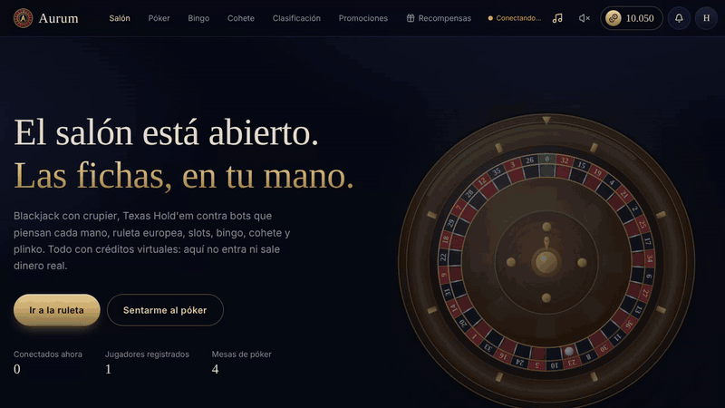
</p>

**Aurum** es un casino social completo para jugar con amigos: siete juegos en tiempo real, salas privadas, amigos, chat, misiones y cajas de recompensas, con un panel de administración de nivel profesional. Se juega **solo con créditos virtuales**: no hay pagos, depósitos, retiradas ni premios reales.

Funciona entero en tu PC con un solo comando, sin bases de datos que instalar ni servicios de pago, y se puede publicar gratis en internet.

> [!IMPORTANT]
> Aurum es un proyecto de entretenimiento y demostración. Los créditos no se compran ni se canjean por nada de valor. La interfaz recuerda en cada juego que los resultados son independientes, no hay giros automáticos ni mensajes engañosos de «casi premio», y los porcentajes de devolución se publican.

<details>
<summary><b>Índice</b></summary>

- [Juegos](#-juegos)
- [Recompensas y vida social](#-recompensas-y-vida-social)
- [Panel de administración](#-panel-de-administración)
- [Cómo funciona](#-cómo-funciona)
- [Empezar en 2 minutos](#-empezar-en-2-minutos)
- [Publicarlo en internet](#-publicarlo-en-internet)
- [Tecnologías](#-tecnologías)
- [Estructura del proyecto](#-estructura-del-proyecto)
- [Pruebas](#-pruebas)
- [Seguridad](#-seguridad)
- [Documentación](#-documentación)
- [Solución de problemas](#-solución-de-problemas)
- [Licencia](#-licencia)

</details>

## 🎰 Juegos

<table>
  <tr>
    <td width="50%" valign="top">
      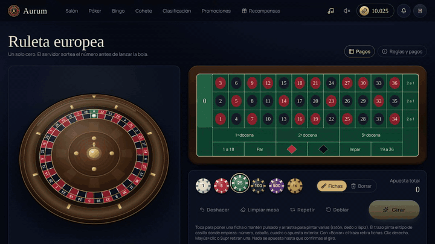
      <h3>Ruleta europea</h3>
      Todas las apuestas, pintadas arrastrando con ratón o dedo, con deshacer y <b>formaciones guardadas</b>. La bola frena, cae y rebota hasta el número que ya decidió el servidor. Versión 3D hiperrealista en equipos con gráfica.
    </td>
    <td width="50%" valign="top">
      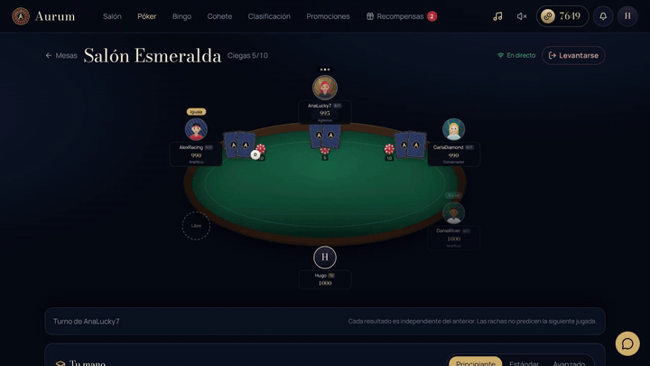
      <h3>Texas Hold'em</h3>
      Mesas de 6 con ciegas, botes secundarios y all-in contra personas reales y bots con estilos propios (siempre marcados como BOT). <b>Asistente de manos</b> que explica tu jugada y la probabilidad exacta de mejorar.
    </td>
  </tr>
  <tr>
    <td width="50%" valign="top">
      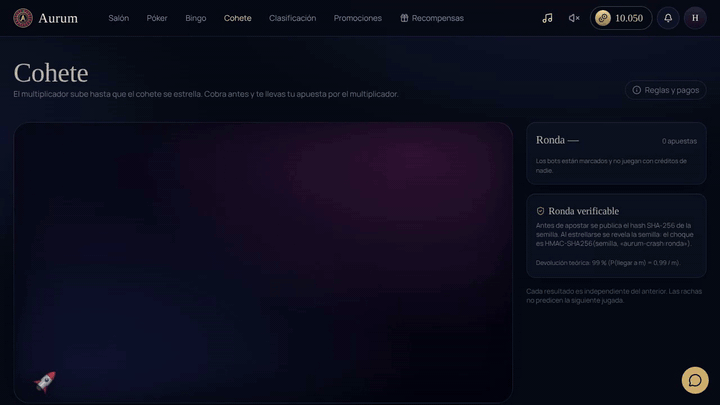
      <h3>Cohete</h3>
      Ronda compartida en tiempo real: el multiplicador sube cada vez más rápido y hay que cobrar antes de que se estrelle. Cobro manual o automático y <b>resultado verificable</b>: el hash se publica antes de apostar.
    </td>
    <td width="50%" valign="top">
      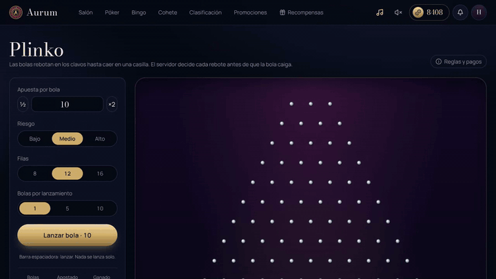
      <h3>Plinko</h3>
      8, 12 o 16 filas y tres niveles de riesgo. Las bolas rebotan y la campana de Gauss se forma en directo. Devolución del 99 %.
    </td>
  </tr>
  <tr>
    <td width="50%" valign="top">
      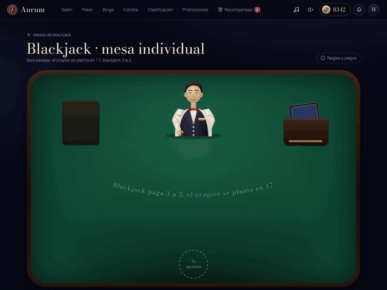
      <h3>Blackjack</h3>
      Zapato de 6 barajas con penetración real y crupier ilustrado con gestos. Doblar y dividir, mesa individual y <b>mesas multijugador</b> de hasta 7 asientos.
    </td>
    <td width="50%" valign="top">
      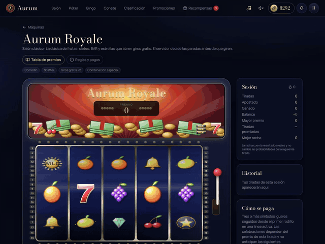
      <h3>Tragaperras</h3>
      <i>Aurum Royale</i> y <i>Tesoro del Arrecife</i>, con giros gratis, comodines y bono de cofres. RTP exacto calculado desde la definición de cada máquina (≈ 96 %).
    </td>
  </tr>
  <tr>
    <td width="50%" valign="top">
      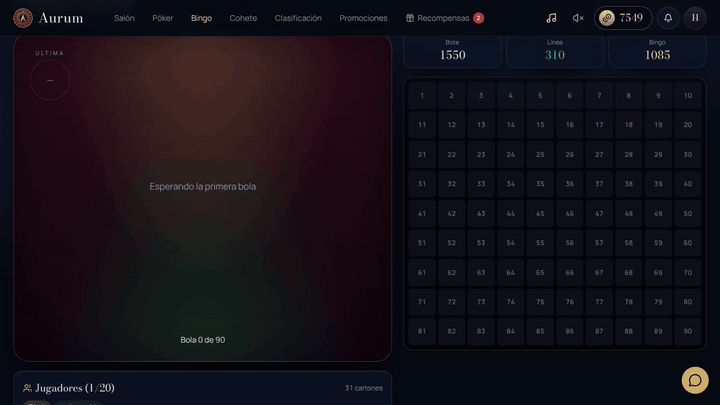
      <h3>Bingo de 90 bolas</h3>
      Bombo con física en 3D, salas públicas de hasta 20 jugadores y salas privadas con código. Línea y bingo del bote.
    </td>
    <td width="50%" valign="top">
      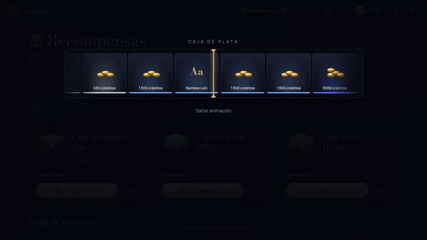
      <h3>Cajas de recompensas</h3>
      Se abren con una cinta que frena en el premio que ya sorteó el servidor, con sonido propio. Probabilidades y devolución media publicadas en la tienda.
    </td>
  </tr>
</table>

## 🎁 Recompensas y vida social

| Función | Qué incluye |
| --- | --- |
| 🎯 **Misiones** | 3 diarias y 5 semanales que avanzan solas al jugar y dan cajas. |
| 🎨 **Cosméticos** | Dorsos de cartas que ven todos en tus cartas boca abajo, marcos animados para la foto y colores de nombre. Se equipan desde Recompensas o desde el perfil. |
| 👥 **Amigos y salas privadas** | Solicitudes, presencia en tiempo real e invitaciones a salas de póker, blackjack y bingo con código. |
| 💬 **Chat de mesa** | Mensajes rápidos, emojis y bocadillos sobre el asiento, con filtro de palabrotas y silenciar. |
| 🏆 **Logros y estadísticas** | Rachas, mejores premios e historial completo de partidas y movimientos. |
| 🎵 **Ambiente** | Banda sonora de jazz generada en directo, que baja al entrar en una mesa, y sonidos sintetizados. Todo original, sin licencias de terceros. |

## 📊 Panel de administración

<p align="center">
  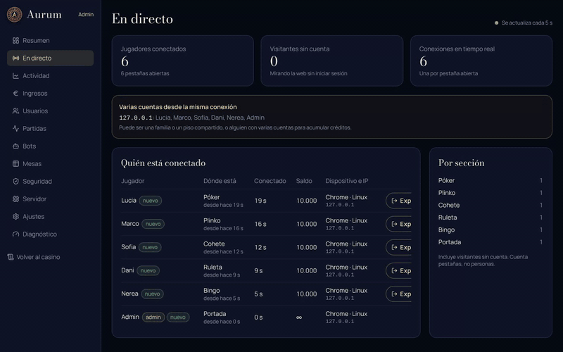
</p>

- **En directo**: quién está conectado, en qué juego o mesa, desde qué dispositivo, y botón para expulsar. Avisa si varias cuentas comparten conexión.
- **Actividad y economía**: activos por día, semana y mes, retención, visitas por sección, beneficio de la casa y de dónde salen los créditos.
- **Ingresos**: ganancias reales de AdSense (por día, RPM, páginas vistas) y bloques de anuncio fuera de las partidas.
- **Seguridad**: comprobaciones automáticas, intentos de acceso y escaneos detectados, posibles multicuentas, `npm audit` diario y revisión del libro mayor.
- **Servidor**: CPU, memoria, disco y tiempos de respuesta de la última hora.
- **Verificación en dos pasos** obligatoria para entrar y **avisos al móvil por Telegram** (ataques, premios grandes, fallos o caídas).

## 🧠 Cómo funciona

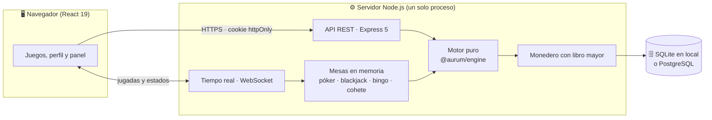

- **El servidor decide siempre.** Cada resultado sale de un generador criptográfico en el servidor antes de animarse en pantalla: el navegador solo lo representa.
- **Un monedero que cuadra.** Cada movimiento guarda saldo anterior y posterior, motivo y partida. Liquidación única con idempotencia (reintentar no cobra dos veces), sin saldos negativos, y una revisión diaria comprueba que todo cuadra.
- **Motor puro y probado.** Las reglas de los siete juegos viven en `packages/engine`, sin red ni base de datos, y tienen cientos de pruebas, incluido el cálculo exacto del RTP.

<details>
<summary><b>Resultados verificables en el cohete</b></summary>

Antes de cada ronda se publica `SHA-256(semilla)`. El punto de choque se calcula como `HMAC-SHA256(semilla, "aurum-crash:N")` y sigue la distribución `P(llegar a m) = 0,99 / m`. Al terminar se revela la semilla, y cualquiera puede comprobar que el resultado ya estaba fijado antes de apostar y que no se cambió después.

</details>

## 🚀 Empezar en 2 minutos

**Necesitas** [Node.js](https://nodejs.org) 22.13 o superior (mejor la LTS) en Windows, macOS o Linux. La base de datos SQLite viene dentro de Node: no hay que instalar nada más.

```bash
git clone https://github.com/Hugosc05/AurumCasinoOnline.git
cd AurumCasinoOnline
npm install
npm run admin:create -- --username admin --email admin@example.com
npm run jugar
```

Abre **http://localhost:3001**, regístrate y a jugar. `admin:create` pide la contraseña por teclado. Entra en `/admin` con esa cuenta para ver el panel.

<details>
<summary><b>Todos los comandos</b></summary>

| Comando | Para qué |
| --- | --- |
| `npm run jugar` | Compila y arranca la versión optimizada (http://localhost:3001) |
| `npm run dev` | Desarrollo: servidor con recarga automática + Vite (http://localhost:5173) |
| `npm run online` | Como `jugar`, pero publicado al momento con un túnel gratuito de Cloudflare para jugar con amigos |
| `npm run build` / `npm start` | Compilar la web / arrancar el servidor por separado |
| `npm test` | Pruebas unitarias y de integración (Vitest) |
| `npm run test:pg` | Las pruebas del servidor contra PostgreSQL real (PGlite) |
| `npm run test:e2e` | Pruebas de extremo a extremo en el navegador (Playwright) |
| `npm run typecheck` | Tipos estrictos de los tres paquetes |
| `npm run admin:create -- …` | Crear o promover un administrador (`--promote usuario`, `--reset-password usuario`) |
| `npm run admin:reset-2fa -w @aurum/server -- --username …` | Quitar la verificación en dos pasos si se pierde el móvil |
| `npm run db:backup -w @aurum/server` | Copia de seguridad en caliente de la base de datos |
| `npm run db:import -w @aurum/server` | Traer todos los datos de PostgreSQL (Supabase) a SQLite |
| `npm run rtp` | Recalcular el RTP exacto de las tragaperras |

Las migraciones y los datos de demostración (bots y mesas) se aplican solos al arrancar.

</details>

## 🌐 Publicarlo en internet

Tres formas, todas gratuitas:

| Opción | Para qué | Guía |
| --- | --- | --- |
| ⚡ **Túnel al momento** | Una partida con amigos ahora, desde tu PC | `npm run online` |
| 🏠 **Servidor en casa** | Un mini PC con Windows siempre encendido, sin límites de uso. Un script lo instala todo: servicio de Windows, HTTPS público con Tailscale, copias diarias | [DEPLOY-CASA.md](DEPLOY-CASA.md) |
| ☁️ **Render + Supabase** | En la nube sin ordenador propio (el plan gratuito tiene horas limitadas al mes) | [DEPLOY.md](DEPLOY.md) |

## 🧰 Tecnologías

<table>
  <tr><td><b>Web</b></td><td>React 19 · TypeScript estricto · Vite 6 · Tailwind CSS · Motion · three.js · Web Audio</td></tr>
  <tr><td><b>Servidor</b></td><td>Node.js · Express 5 · WebSocket (<code>ws</code>) · Zod · Helmet</td></tr>
  <tr><td><b>Datos</b></td><td>SQLite integrado en Node (<code>node:sqlite</code>) o PostgreSQL, con las mismas migraciones</td></tr>
  <tr><td><b>Calidad</b></td><td>Vitest · Playwright · PGlite (PostgreSQL real en las pruebas)</td></tr>
</table>

## 📁 Estructura del proyecto

```
packages/engine   Motores puros: cartas, blackjack, póker (evaluador, botes, bots), ruleta, slots,
                  bingo, cohete, plinko, cajas, misiones y logros
apps/server       API REST + WebSocket, monedero, autenticación, mesas, salas, chat,
                  recompensas, panel de administración (seguridad, 2FA, avisos, métricas) y CLI
apps/web          Interfaz React: salón, juegos, perfil, recompensas, amigos, salas y panel
deploy/windows    Instalador, actualizador y estado del servidor en casa
e2e               Pruebas de extremo a extremo
docs              Guía de animación e imágenes del README
```

## 🧪 Pruebas

| Batería | Pruebas | Qué cubre |
| --- | ---: | --- |
| `npm test` | 468 | Motores, reglas, RTP, monedero, API, tiempo real, 2FA, panel |
| `npm run test:pg` | 141 | El servidor completo contra PostgreSQL real |
| `npm run test:e2e` | 23 | Flujos reales en Chromium: registro, juegos, salas, chat, animaciones |

## 🔒 Seguridad

- Contraseñas con scrypt, sesiones con cookie `httpOnly` y `SameSite=Strict`, y protección CSRF y de origen en la API y el WebSocket.
- Límites contra fuerza bruta, bloqueo temporal de cuentas y detección de escáneres de vulnerabilidades.
- Verificación en dos pasos (TOTP) obligatoria en el panel, con códigos de recuperación.
- Cabeceras de seguridad (CSP, HSTS), consultas parametrizadas y validación de todas las entradas con Zod.
- Credenciales externas cifradas con AES-256-GCM. `npm audit` diario con aviso al móvil.

Detalles y cómo informar de un fallo: [SECURITY.md](SECURITY.md).

## 📚 Documentación

| Documento | Contenido |
| --- | --- |
| [ARCHITECTURE.md](ARCHITECTURE.md) | Arquitectura, diagramas y decisiones técnicas |
| [GAME_RULES.md](GAME_RULES.md) | Reglas, pagos y RTP de cada juego |
| [API.md](API.md) | Endpoints REST y protocolo WebSocket |
| [SECURITY.md](SECURITY.md) | Modelo de seguridad |
| [TESTING.md](TESTING.md) | Qué se prueba y cómo |
| [DEPLOY-CASA.md](DEPLOY-CASA.md) · [DEPLOY.md](DEPLOY.md) | Publicarlo en casa o en la nube |
| [docs/ANIMATION_GUIDE.md](docs/ANIMATION_GUIDE.md) | Sistema de animación y dirección artística |
| [CHANGELOG.md](CHANGELOG.md) · [PROJECT_STATUS.md](PROJECT_STATUS.md) · [CONTRIBUTING.md](CONTRIBUTING.md) | Novedades, estado y cómo contribuir |

## 🩺 Solución de problemas

<details>
<summary><b>Problemas frecuentes y soluciones</b></summary>

| Síntoma | Causa probable y solución |
| --- | --- |
| `No such built-in module: node:sqlite` | Node anterior a 22.13. Actualiza a la versión LTS. |
| `EADDRINUSE: 3001` o `5173` | Otro programa usa el puerto. Ciérralo o cambia `PORT` en `.env`. |
| Error de `rollup` o `esbuild` al instalar | Instalación interrumpida. Borra `node_modules` y `package-lock.json` y ejecuta `npm install`. |
| «Sin conexión en tiempo real» | El servidor no está en marcha o el puerto no coincide. |
| No puedo iniciar sesión con `NODE_ENV=production` por HTTP | Las cookies seguras exigen HTTPS. Usa `COOKIE_SECURE=false` solo en local. |
| «Cuenta bloqueada temporalmente» | 5 intentos fallidos en 15 minutos. Espera unos minutos. |
| Los efectos 3D van lentos | Sin tarjeta gráfica, Aurum usa automáticamente la versión 2D. |
| Empezar de cero | Para el servidor y borra `apps/server/data/aurum.db*` (se pierden cuentas y saldos). |

</details>

<details>
<summary><b>Límites conocidos</b></summary>

- Las mesas viven en la memoria de un único proceso: no hay escalado horizontal. Tras un reinicio, las salas privadas siguen abiertas pero con la mesa vacía, y las fichas de póker se devuelven a sus dueños.
- Los bots juegan de forma razonable, pero no son óptimos ni invencibles.
- No se implementan el seguro ni la rendición en blackjack.
- Para mostrar anuncios de AdSense hace falta un dominio propio.

Más detalle en [PROJECT_STATUS.md](PROJECT_STATUS.md).

</details>

## 📄 Licencia

[MIT](LICENSE). Proyecto de entretenimiento sin dinero real.

<p align="center">
  <a href="#inicio">Volver arriba ↑</a>
</p>
