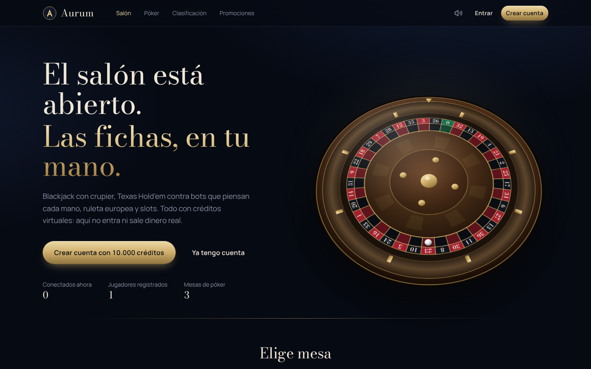
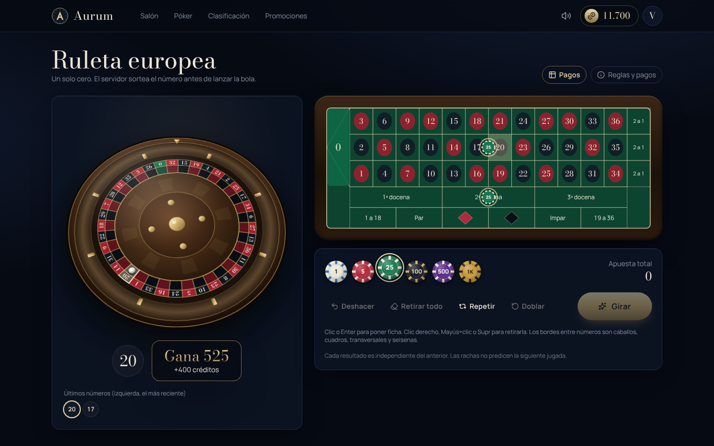
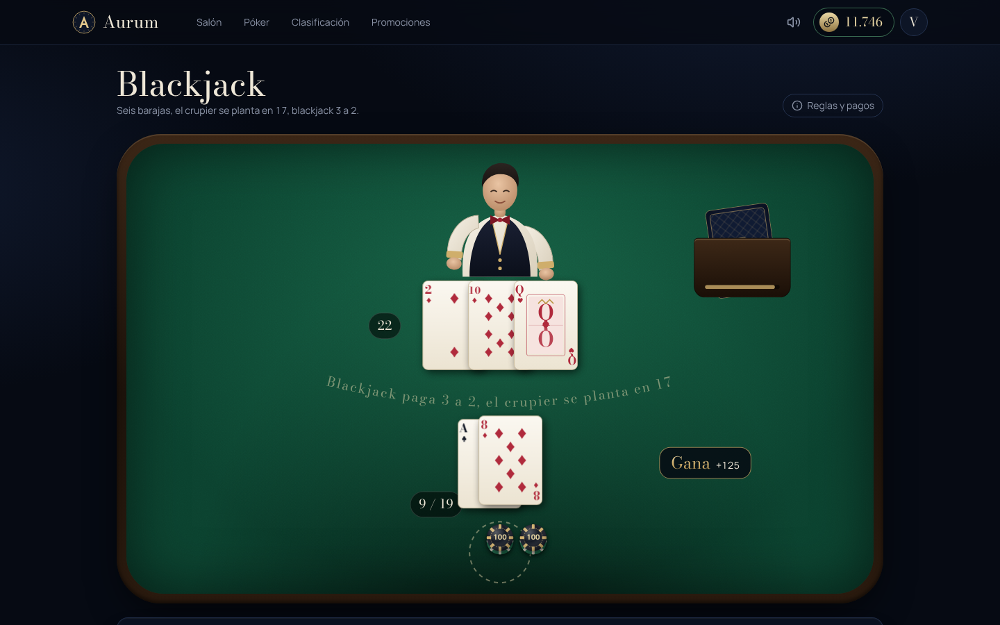
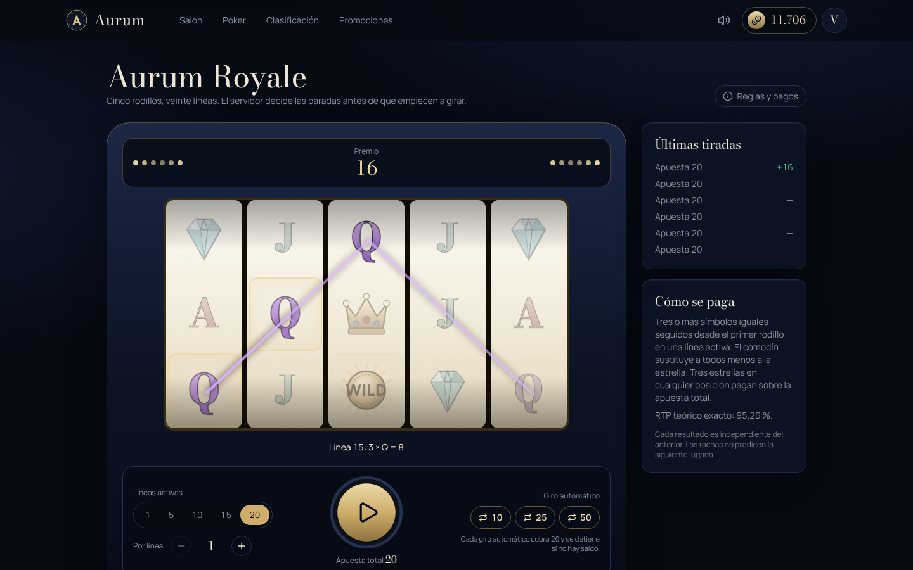

# Aurum — casino con moneda virtual

Plataforma de casino **exclusivamente de demostración**: blackjack con crupier animado, Texas Hold'em en tiempo real contra bots con estrategia propia, ruleta europea con bola física y slots de cinco rodillos. Se juega con créditos virtuales sin valor económico: no hay pagos, depósitos, retiradas ni conversión a dinero real.

Todo funciona en local, con coste 0 €: sin servicios externos, sin APIs de pago y sin binarios nativos que compilar.



| Ruleta | Blackjack | Slots |
| --- | --- | --- |
|  |  |  |

> Las capturas se tomaron de la aplicación real en ejecución (Chromium, 1440 × 900).

## Qué incluye

- **Cuentas**: registro, inicio de sesión por usuario o correo, sesiones con cookie httpOnly, bloqueo temporal tras intentos fallidos, perfil con estadísticas, historial, movimientos, logros y preferencias de sonido y animación.
- **Monedero virtual transaccional**: cada movimiento guarda saldo anterior y posterior, motivo y partida; liquidación única, idempotencia y sin saldos negativos.
- **Blackjack**: zapato de 6 barajas con penetración real, barajado tipo *riffle*, crupier 2D con poses, reparto carta a carta con trayectoria, sombra y volteo; doblar y dividir.
- **Texas Hold'em**: mesas de 6 con ciegas, botes secundarios, all-in, temporizador de turno, multijugador humano real por WebSocket y bots con cuatro perfiles (conservador, agresivo, equilibrado, analítico) y tres dificultades.
- **Ruleta europea**: tapete interactivo con todas las apuestas (pleno, caballo, transversal, cuadro, seisena, docenas, columnas, sencillas), rueda 2.5D con bola que frena, cae y rebota hasta el número que ya decidió el servidor.
- **Slots Aurum Royale**: 5 × 3, 20 líneas, comodín y scatter, parada escalonada y anticipación; **RTP teórico exacto 95,2552 %** calculado por enumeración.
- **Administración**: métricas, usuarios (ajuste de saldo con motivo, suspensión), partidas, bots, mesas, juegos habilitados, errores, auditoría y comprobación del libro mayor. El administrador tiene saldo ilimitado sin poder obtenerlo desde el cliente.

## Requisitos

- **Node.js 22.13 o superior** (recomendado Node 24 LTS). Se usa el módulo SQLite integrado en Node (`node:sqlite`), así que no hace falta instalar ninguna base de datos.
- npm 10 o superior (viene con Node).
- Windows 10/11, macOS o Linux.

Comprueba tu versión con `node -v`. Si es anterior a 22.13, instala la LTS actual desde nodejs.org.

## Puesta en marcha (Windows, PowerShell o CMD)

```powershell
cd C:\PROYECTOS\Casino
npm install
copy .env.example .env          # opcional: valores por defecto razonables
npm run admin:create -- --username admin --email admin@example.com
npm run dev
```

Abre **http://localhost:5173**. El servidor de la API escucha en el puerto 3001 y Vite redirige `/api` y `/ws` hacia él.

`admin:create` pide la contraseña por teclado (mínimo 10 caracteres, letras y números). También puedes definir `ADMIN_PASSWORD` en el entorno. Para dar el rol a una cuenta ya registrada: `npm run admin:create -- --promote nombre_de_usuario`. Para restablecer una contraseña: `npm run admin:create -- --reset-password nombre_de_usuario`.

### Modo producción local (un solo proceso y un solo puerto)

```powershell
npm run build
npm start
```

Abre **http://localhost:3001**: el servidor entrega también el frontend compilado.

### Parar

`Ctrl + C` en la terminal. Al apagarse, el servidor devuelve a sus dueños las fichas que hubiera en las mesas de póker. Si el proceso se corta de golpe, esas fichas se reembolsan automáticamente en el siguiente arranque.

## Comandos

| Comando | Para qué |
| --- | --- |
| `npm run dev` | Servidor (recarga automática) + frontend Vite |
| `npm run build` | Compila el frontend en `apps/web/dist` |
| `npm start` | Arranca el servidor (sirve `dist` si existe) |
| `npm test` | 153 pruebas unitarias y de integración (Vitest) |
| `npm run test:e2e` | 7 pruebas de extremo a extremo con Playwright |
| `npm run typecheck` / `npm run lint` | Comprobación de tipos estricta de los tres paquetes |
| `npm run db:migrate` | Aplica migraciones pendientes |
| `npm run db:seed` | Inserta bots y mesas de demostración (idempotente) |
| `npm run admin:create -- …` | Crea o promueve un administrador |
| `npm run rtp` | Recalcula el RTP exacto de las slots |

Las migraciones y los datos de demostración se aplican solos al arrancar el servidor.

## Tecnologías

- **Frontend**: React 19, TypeScript estricto, Vite 6, Tailwind CSS 3, Motion (Framer Motion), Lucide. Tipografías Bodoni Moda y Manrope autoalojadas (sin peticiones a terceros).
- **Backend**: Node.js, Express 5, `ws`, Zod, Helmet.
- **Datos**: SQLite integrado en Node con migraciones SQL versionadas y repositorio propio; preparado para migrar a PostgreSQL (ver [ARCHITECTURE.md](ARCHITECTURE.md)).
- **Pruebas**: Vitest y Playwright.
- **Audio**: sonidos sintetizados en el navegador con Web Audio (originales, sin licencias de terceros).

## Estructura

```
packages/engine   Motores puros: cartas, blackjack, póker (evaluador, mesa, botes, bots), ruleta, slots, logros
apps/server       API REST + WebSocket, monedero, autenticación, mesas de póker, administración, CLI
apps/web          Interfaz React: salón, juegos, perfil, promociones, panel de administración
e2e               Pruebas de extremo a extremo
docs              Guía de animación y capturas
```

## Documentación

- [ARCHITECTURE.md](ARCHITECTURE.md): arquitectura, diagramas y decisiones técnicas
- [GAME_RULES.md](GAME_RULES.md): reglas, pagos y RTP de los cuatro juegos
- [SECURITY.md](SECURITY.md): modelo de seguridad
- [API.md](API.md): endpoints REST y protocolo WebSocket
- [TESTING.md](TESTING.md): qué se prueba y cómo
- [docs/ANIMATION_GUIDE.md](docs/ANIMATION_GUIDE.md): sistema de animación y dirección artística
- [CONTRIBUTING.md](CONTRIBUTING.md), [CHANGELOG.md](CHANGELOG.md), [PROJECT_STATUS.md](PROJECT_STATUS.md)

## Solución de problemas

| Síntoma | Causa probable y solución |
| --- | --- |
| `No such built-in module: node:sqlite` | Node anterior a 22.13. Actualiza a Node 22.13+ o 24 LTS. |
| Aviso `ExperimentalWarning: SQLite` | Inofensivo; los scripts ya lo silencian. |
| `EADDRINUSE: 3001` o `5173` | Otro proceso usa el puerto. Ciérralo o cambia `PORT` en `.env` (y `AURUM_API` para Vite). |
| Error de `@rollup/rollup-win32-…` o `esbuild` al instalar | Instalación interrumpida o `node_modules` copiada desde otro sistema. Borra `node_modules` y `package-lock.json` y ejecuta `npm install` de nuevo. |
| La interfaz dice «Sin conexión en tiempo real» | El servidor no está en marcha o el puerto no coincide. Revisa la terminal del servidor. |
| No puedo iniciar sesión en `npm start` tras HTTPS | Si sirves por HTTP con `NODE_ENV=production`, define `COOKIE_SECURE=false`. |
| «Cuenta bloqueada temporalmente» | 5 intentos fallidos en 15 minutos. Espera o reinicia el servidor. |
| Quiero empezar de cero | Para el servidor y borra `apps/server/data/aurum.db*` (perderás cuentas y saldos). |

## Límites conocidos

Resumidos aquí; detalle en [PROJECT_STATUS.md](PROJECT_STATUS.md).

- Los bots juegan de forma razonable, pero no son óptimos ni invencibles (ver [GAME_RULES.md](GAME_RULES.md#bots)).
- Las mesas de póker viven en memoria del proceso: no hay escalado horizontal (un solo servidor).
- No se implementan seguro ni rendición en blackjack, ni giros gratis en slots.
- El crupier y la ruleta son 2D/2.5D (SVG), no 3D.

## Licencia

MIT. Proyecto de demostración sin dinero real.
